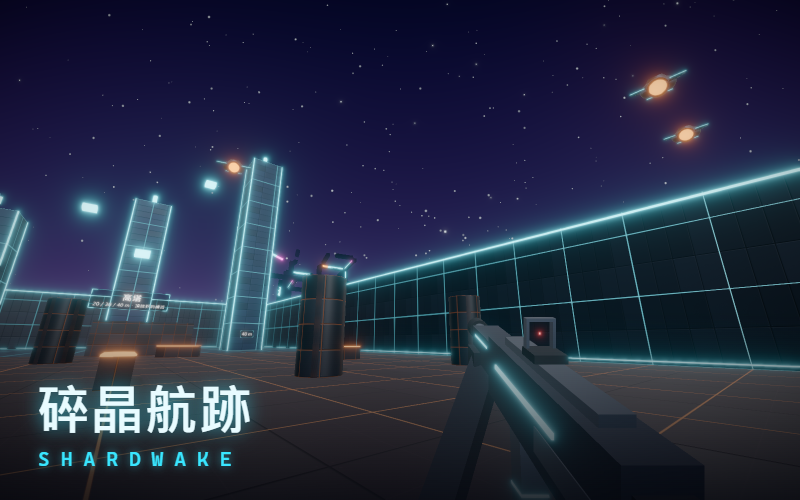

# 碎晶航跡 SHARDWAKE

> 在崩解的軌道巨構碎片間高速穿梭、奪取原型武器的單人第一人稱科幻刷寶射擊遊戲。



- 狀態：**M1-16 完成——v0.1 手感原型可以交付**（效能剖析與熱迴圈最佳化、錯誤畫面、`#cover` 封面模式與正式封面、完整 `game.json`、說明文件）。下一步：[M1-17 發布流程與 v0.1.0](docs/plans/M1-17-release-v0.1.md)，推送 tag、建立 Release 與平台上架都**需要使用者明確授權**。
- 平台：Playroom（桌面瀏覽器，鍵盤＋滑鼠），遊戲 ID `shardwake`，版本 0.1.0。
- 技術：TypeScript、Vite、Three.js、Rapier（單執行緒 WASM）、pmndrs postprocessing、Tweakpane、Web Audio、Vitest；幾何、貼圖與音效全部程序生成，不使用外部素材。

## 文件

- [總計畫與進度](PLAN.md)
- [設計總覽](docs/design.md)
- [詳細計畫](docs/plans/)（每份計畫末尾的「實作紀錄」有實際數值、驗證結果與未驗證項目）
- [開發規範（AGENTS.md）](AGENTS.md)

## 遊戲簡介

v0.1 是「手感原型」：在疾行者訓練場裡練習整套移動技、試射 5 把原型武器、對付會反擊的訓練無人機、挑戰跑酷計時賽。刷寶、敵人、任務與成長系統在 M2 之後加入。

- **移動**：自動衝刺、蹲與滑鏟（下坡越滑越快）、跳躍與攀爬、跑牆與蹬牆跳、二段跳與噴射、Dash（2 次充能）、抓鉤。
- **武器**：突擊步槍「斷流」（全自動）、散射霰彈槍「碎浪」（泵動、逐發裝填）、重型手炮「裂錨」（半自動）、磁軌狙擊槍「垂線」（4 倍鏡、穿透）、電漿發射器「曙核」（爆炸、可火箭跳）。
- **訓練場**：出生平台、中央廣場、靶場（假人、移動靶、DPS 計）、跑牆長廊、Z 字牆板與深坑、滑鏟長坡、半管、攀爬測試牆、浮台群、無人機戰區、20 m 高塔與抓鉤點；掉進深坑回到最近的檢查點。
- **跑酷計時賽**：起點門 → 跑牆長廊 → Z 字牆板 → 20 m 塔頂 → 半管 → 浮台群 → 終點，共 10 個門，本機保存最佳成績與分段。

## 操作

標題畫面按「點擊開始」（或點擊面板以外的畫面）：會鎖定滑鼠並啟用音效。所有按鍵都可以在暫停選單的「按鍵配置」重新綁定。

| 動作 | 預設按鍵 | 說明 |
| --- | --- | --- |
| 移動 | W A S D | 往前 ±50° 內自動衝刺；開火或開鏡時降回跑速（設定可改手動衝刺） |
| 視角 | 滑鼠 | 靈敏度為 Source／Apex 尺度，設定頁同時顯示 cm/360 |
| 跳躍 | Space | 落地前 0.15 s 內按也會起跳、走出平台 0.12 s 內仍可起跳；面對 0.5–2.0 m 的邊緣自動攀上；跑牆中按為蹬牆跳；空中再按為二段跳；二段跳後按住為噴射 |
| 蹲下／滑鏟 | C | 7 m/s 以上按下為滑鏟（推進 +3.5 m/s，冷卻 1.2 s）；空中按住落地直接接滑鏟（Ctrl+W 會關分頁，所以預設不用 Ctrl） |
| Dash | 左 Shift | 0.15 s 位移 7 m，2 次充能各 1.8 s；地面 Dash 結束時按住 C 接滑鏟 |
| 抓鉤 | F | 準星下方出現「可勾取」時按住；打到高塔、外牆或青色抓鉤點會被拉過去；按 Space 脫鉤並上拋 |
| 射擊／開鏡 | 滑鼠左鍵／右鍵 | 開鏡靈敏度依焦距自動換算，再乘設定的倍率 |
| 換彈／近戰 | R／V | 打空自動換彈；近戰在 3.5 m 內會突進吸附 |
| 切換武器 | 1–5、滾輪、Q | 1 步槍、2 霰彈、3 手炮、4 狙擊、5 電漿；Q 切回前一把 |
| 重來計時賽 | T | 隨時回到計時賽起點 |
| 暫停選單 | Esc | 設定、按鍵配置、操作說明、重置位置、重新開始訓練、跑酷計時賽、返回標題 |
| 調參面板（開發用） | `` ` `` | 見「開發用功能」 |
| 錄製／重播輸入（開發用） | F8／F9 | 見「錄製與重播」 |

### 選單、設定與 HUD

- **暫停選單**：按 Esc，或滑鼠鎖定被瀏覽器解除、切到其他分頁時自動暫停。「繼續」要點擊（瀏覽器規定重新鎖定滑鼠需要點擊；剛解除鎖定約 1 秒內 Chrome 可能拒絕，選單會提示再點一次）。
- **設定**（立即套用，存在 `shardwake:settings:v1`，每頁可「恢復預設」）：
  - 控制：靈敏度、滑鼠 DPI（換算 cm/360）、開鏡靈敏度倍率、Y 軸反轉、自動衝刺、蹲下／開鏡／抓鉤按住或切換。
  - 畫面：水平視野、畫質（低／中／高）、渲染比例、陰影、Bloom（後三項預設「跟隨畫質」）、顯示 FPS（預設開啟，方便回報效能）。
  - 鏡頭：畫面震動、鏡頭傾斜、頭部晃動、動態視野、速度線、落地下沉、畫面色差。容易暈的話把兩個強度調到 0% 並關閉其他項目，鏡頭就完全穩定。
  - 回饋：命中標記、傷害數字、合併傷害數字、訓練無人機。
  - 音效：主音量、音效、介面。
- **按鍵配置**：每個動作有主要與次要兩欄；Esc 取消、Backspace 清除；衝突時可「取代」；F1、F5、F11、F12 等瀏覽器保留鍵不能綁。存在 `shardwake:bindings:v1`。
- **HUD**：左下護盾／生命（延遲條）、Dash 充能、噴射燃料、抓鉤冷卻環；中央準星（大小等於實際散布）、命中標記、「可勾取」提示；右下武器欄位、彈藥、射擊模式、換彈進度；上方提示訊息與計時賽計時。HUD 依遊戲畫面短邊縮放，超寬螢幕往中間收。
- **畫質預設**：低 = 渲染比例 67%、無陰影、無 Bloom、無 SMAA；中 = 85%、陰影 1024、Bloom、SMAA；高 = 100%、陰影 2048、Bloom、SMAA。
- **儲存**：本機 key 一律以 `shardwake:` 開頭並帶版本（`settings:v1`、`bindings:v1`、`presets:v1`、`replay:v1:<名稱>`、`replays:v1`、`besttimes:v1`）。隱私模式或儲存被停用時改用記憶體，遊戲照常可玩，選單會提示「只保留到關閉頁面」。
- **錯誤畫面**：瀏覽器無法使用 WebGL 2、顯示卡繪圖中斷（context lost）、物理引擎（WebAssembly）載入失敗、遊戲檔案下載失敗或執行中連續出錯時，顯示中文說明、可展開的錯誤細節與「重試」按鈕（重新載入遊戲；設定與成績保存在瀏覽器中不會遺失）。繪圖中斷後若瀏覽器自動恢復，錯誤畫面會自動關閉並回到暫停選單。

## 開發指令

需要 Node 22.12 以上（開發使用 Node 24）。套件全部固定版本，請用 `npm ci` 安裝。

```sh
npm ci                # 安裝固定版本的套件
npm run dev           # 開發伺服器
npm run typecheck     # TypeScript 型別檢查
npm test              # 單元測試（含 Rapier 無頭模擬）；npm run test:watch 為監看模式
npm run build         # 型別檢查後建置成平台成品到 dist/
npm run check:dist    # 快速檢查成品格式（正式驗證用平台 game:validate，見 M1-17）
npm run preview       # 以 Vite 預覽 dist/
npm run sim           # 平台模擬頁：http://localhost:4173/ 以跨來源 sandbox iframe 載入 dist/
npm run check:browser # 本機 Chrome／Edge headless 煙霧測試（需先 build；-- --browser edge）
npm run perf          # 效能探針：戰鬥＋高速移動腳本的 frame time、draw call、GC 與記憶體配置（需先 build）
npm run cover         # 以 headless 瀏覽器開 #cover 產生正式封面 public/cover.png（需先 build）
npm run demo:record   # 移動參數改了導致 #demo 失準時，重新錄製 src/debug/demo-clip.json
```

每份計畫完成前必須通過 `npm run typecheck`、`npm test`、`npm run build`、`npm run check:dist`。

- **平台模擬頁**：遊戲來源是 `http://127.0.0.1:4174/games/shardwake/<version>/`（另有 `/preview/...` 入口），可切換一般／填滿視窗（沉浸）／原生全螢幕、調整 iframe 尺寸。埠號被占用時設定 `SIM_PLATFORM_PORT`、`SIM_GAME_PORT`。
- **headless 腳本**（`check:browser`、`perf`、`cover`）只使用本機已安裝的 Chrome 或 Edge（`--browser edge`；路徑可用環境變數 `SW_CHROME`／`SW_EDGE` 指定），以獨立的暫存使用者資料夾啟動、使用實體 GPU（ANGLE D3D11），結束時只關閉自己啟動的程序。不需要也不會下載 Playwright／Puppeteer 的瀏覽器。
- **`npm run check:browser`** 實測：直接開啟並開始遊玩、`#cover` 封面模式、`#demo` 連招、平台模擬頁跨來源 iframe 內的 `#demo`、儲存不可用、WebGL context lost 與恢復、執行中連續例外、停用 WebGL、WebAssembly 被封鎖、遊戲檔案下載失敗（`--only boot,demo` 只跑部分）。
- **`npm run perf`** 選項：`--seconds 30`（rAF 量測秒數）、`--frames 600`（同步吞吐量畫面數；0 = 略過）、`--matrix`（高畫質下個別關閉陰影／Bloom、降低渲染比例的成本拆解）、`--vsync`（保留瀏覽器幀率限制）、`--panel`（量測時保持調參面板開啟）、`--width/--height`、`--dist`、`--json <輸出>`。不限幀率時 rAF 的長畫面主要是 GPU 佇列滿造成的等待（見 M1-16 實作紀錄），判讀 GPU 能力看同步吞吐量。

## 開發用功能

### 網址旗標（hash）

| 旗標 | 作用 |
| --- | --- |
| `#debug` | 開啟調參面板，並把核心物件掛到 `window.__shardwake`（`game`、`settings`、`player`、`weapons`、`targets`、`hud`、`menuActions`、`tools`、`renderer`、`postfx`、`errorScreen`、`frameGuard` 等）供主控台與自動化使用 |
| `#nolock` | 不鎖定滑鼠（點擊直接開始，沒有滑鼠視角），方便在開發者工具中除錯 |
| `#demo` | 載入後自動開始，用標準參數重播內建錄影，展示「滑鏟 → 跑牆 → 蹬牆跳 → 二段跳 → Dash → 抓鉤」；`<html>` 的 `data-sw-demo` 為 `pending`／`running`／`done`／`failed`，另有 `data-sw-demo-combo`、`data-sw-demo-error`（終點誤差 mm） |
| `#cover` | 封面模式：固定在無人機戰區的取景、隱藏 HUD 與選單、以 800 × 500（內部 2 倍超取樣）渲染並凍結；右下角「下載封面」下載 `cover.png`。`data-sw-cover` 為 `pending`／`ready`。取景數值在 `src/tools/cover.ts` 的 `COVER_CONFIG`，`#cover&debug` 時可在調參面板「工具/封面」調整後按「重新取景」。封面模式不寫入玩家設定 |

旗標可以並用，例如 `#demo&debug`。其他供自動化的 `<html>` 屬性：`data-sw-boot`（`loading`／`ready`／`error`）、`data-sw-mode`、`data-sw-menu`、`data-sw-overlay`、`data-sw-error`（錯誤畫面分類）、`data-sw-context`（`lost`／`restored`）。

### 調參面板

遊戲中按 `` ` `` 或網址加上 `#debug` 開啟（Tweakpane，第一次開啟時才載入；關閉時監看停止更新）。開啟時解除滑鼠鎖定但不暫停，點擊畫面恢復滑鼠視角。面板的修改**不存檔**（要保留請存成預設組合）。手感與平衡數值都集中在設定資料，面板直接改寫：

- **效能**：FPS 圖、draw call（含所有後處理 pass）、三角形、幾何、貼圖、每畫面步數。
- **移動**：`MovementConfig` 全部參數（地面、跳躍、空中、蹲與滑鏟、跑牆、蹬牆跳、攀爬、能力開關、二段跳、噴射、Dash、抓鉤、繩索視覺、膠囊與碰撞）與監看（速度曲線、狀態、燃料、充能…）；「移動/除錯顯示/偵測射線」畫出牆面與邊緣偵測。
- **鏡頭**：FOV、傾斜、落地、頭部晃動、震動、眼高、速度線與測試按鈕。
- **武器**：目前手持武器 `WeaponDef` 的所有欄位（切槍時跟著換）、近戰與共用規則、監看（散布、後座、換彈）、工具（匯出 JSON、重設、補滿彈藥）。
- **武器表現**：槍模擺位與動畫、後座、換彈關鍵影格、特效（閃光、曳光、火花、彈孔）、準星樣式。
- **戰鬥**：靶標與無人機、玩家（含無敵模式）、命中與受擊回饋、監看與測試按鈕。
- **視覺**：畫質預設、後處理、燈光與陰影範圍、環境反射、天空與霧、全息看板、材質、圖樣、重新預熱。
- **音效**：混音、壓縮限幅、空間、發聲上限、事件、每種音效音量、**音色編輯**（逐欄調整合成配方並試聽、匯出 JSON）、監看與壓力測試。
- **介面**：HUD 版面、HUD 更新頻率（`updateHz`，預設 60 Hz；0 = 每畫面）、各元件數值。
- **關卡／物理／自由相機**：碰撞體線框、區域與檢查點、傳送；「自由相機/啟用」切換穿牆飛行（WASD、Space 上升、C 下降、Shift 加速）。
- **工具**：預設組合、錄製重播、計時賽、慢動作（0.1×–1×）、傳送到各分區與計時賽起點、封面（`#cover` 時）。

### 預設組合（調參面板「工具」）

把移動參數、鏡頭參數與每把武器的 `WeaponDef` 存成具名組合。內建「標準」（全預設）、「高速」、「穩重」三組，可一鍵套用。「管理預設組合…」對話框可以存成新組合、套用、刪除、匯出、匯入（存在 `shardwake:presets:v1`）：匯出時 JSON 放進文字框並全選（Ctrl+C 複製；能用剪貼簿時同時複製），也可以「下載檔案」存成 `.json`；匯入時貼上 JSON 按「匯入」或「匯入並套用」。套用組合會先把數值回到預設再疊上組合。較新版本的組合檔會被拒絕。

### 錄製與重播

- 遊戲中按 **F8** 開始錄製、再按 F8 停止（最長 120 s）。錄下每個固定步的輸入與起始狀態（位置、速度、移動狀態、能力計時、視角、武器與亂數狀態）；開始錄製時靶標、彈藥、生命與計時賽會重設成一致的起點。
- 按 **F9** 從相同的起始狀態重播，結果逐步完全一致（與畫面更新率、慢動作無關）；重播中玩家輸入不影響結果，再按 F9 停止。
- **比較參數**：改了參數（或套用「高速」）後重播，畫面會畫出原始路徑（青）與新路徑（橘），標記球顯示同一時刻的原始位置；HUD 顯示鬼影時間差（正值 = 比原始慢），結束時顯示終點差與時間差。「套用錄製時的參數」還原，「清除鬼影」隱藏。
- 錄影可在對話框存成具名片段（`shardwake:replay:v1:<名稱>`，最多 12 段）、載入、刪除、匯出或匯入 JSON。

### 著色器預熱

載入時（與切換畫質時）預先編譯所有材質與特效的著色器並上傳貼圖，主控台印出「著色器預熱」的材質、貼圖與程式數；之後第一次看到各區、第一次開火與切槍都不會再編譯著色器。

## 試玩清單

v0.1 交付前請在有實體 GPU 的桌面瀏覽器（Chrome 或 Edge，建議 GTX 1650 等級、1080p、高畫質）實際遊玩並記錄結果；M1-16 只能用 headless 自動化驗證功能（見計畫的實作紀錄）。

**效能**
- [ ] 設定開啟「顯示 FPS」，在無人機戰區一邊高速移動一邊連射 30 秒：高畫質 1080p ≥ 120 FPS，左上角 `max` 欄（最長畫面）大多 < 12 ms；第一次 Dash、第一次抓鉤、第一次開每把槍都沒有卡頓。
- [ ] 切換低／中／高畫質，畫面與 FPS 合理，切回來不再卡頓。

**移動技**（每項至少成功 3 次，記下覺得太快／太慢／太飄的地方）
- [ ] 衝刺 → 滑鏟 → 滑鏟跳；滑鏟長坡越滑越快。
- [ ] 跑牆長廊：斜向跳上牆跑牆、蹬牆跳到對面再跑牆；Z 字牆板左右連續跑牆過深坑。
- [ ] 攀爬測試牆：3.0 m 牆起跳攀上、4.0 m 牆二段跳後攀上。
- [ ] 二段跳後按住噴射；燃料用完會下降，落地後回充。
- [ ] Dash：地面、空中、跑牆中各一次；兩次充能連用；地面 Dash 接滑鏟。
- [ ] 抓鉤：從高塔前方勾上 20 m 塔頂；勾青色抓鉤點；拉動中按 Space 脫鉤上拋。
- [ ] `#demo` 示範的連招自己能做出來。
- [ ] 跑酷計時賽完整跑完 10 個門，最佳成績與分段有保存；T 立即重來。

**武器**（靶場與無人機戰區）
- [ ] 5 把武器各打空一個彈匣並換彈：後座、壓槍、準星大小、槍口閃光、曳光、命中火花、音效清楚且有區別。
- [ ] 霰彈逐發裝填可中斷；狙擊開鏡 4 倍與鏡內遮罩；電漿火箭跳。
- [ ] 靶場 DPS 計數字合理；爆頭命中標記與傷害數字清楚。

**無人機閃避**
- [ ] 進入無人機戰區：用 Dash、滑鏟、跑牆、掩體閃避能量球；受擊方向指示、護盾破裂與低生命暗角清楚但不干擾；死亡後重生。

**調整並匯出預設**
- [ ] F8 錄一段連招 → 套用「高速」→ F9 重播，看鬼影路徑與時間差。
- [ ] 在調參面板改幾個移動與武器數值 → 「管理預設組合…」存成新組合 → 匯出 JSON → 重新整理後匯入，數值完全一致。

**平台與舒適度**
- [ ] `npm run sim` 的平台模擬頁：一般／沉浸／原生全螢幕切換、Esc 暫停、退出全螢幕後繼續遊玩，設定與成績保留。
- [ ] 把鏡頭設定的兩個強度調到 0% 並關閉其他鏡頭效果，確認鏡頭完全穩定。
- [ ] 中文輸入法開啟時 WASD 仍可操作。

## 已知問題

**尚未以真人實機驗證**（M1-01～M1-16 的自動化只在 headless 瀏覽器與無頭模擬中驗證功能；詳細清單見各計畫的「未驗證」）
- 手感數值都還是設計值，沒有依真人試玩調整：跑牆、蹬牆跳、抓鉤、鏡頭效果（震動、傾斜、落地下沉）、後座與壓槍、命中與受擊回饋、無人機難度、HUD 可讀性、音色與混音。M1-16 的「定案值 = 目前值」，最值得試玩時調整的參數列在 [M1-16 實作紀錄](docs/plans/M1-16-polish-perf.md#實作紀錄)。
- GTX 1650 有頭瀏覽器的實際 FPS 與 p99 frame time 未量測：headless（同一張 GTX 1650）的同步吞吐量高畫質 1080p 約 244 FPS（p99 4.7 ms），但不含合成器、vsync 與長時間遊玩；內顯低畫質 ≥ 60 FPS 沒有機器可測。
- 原生全螢幕、Keyboard Lock 下的 Esc、真實滑鼠（高 DPI、甩動跳動、原始輸入）、中文輸入法、Firefox／Safari 都沒有實測。
- 剪貼簿與 Blob 下載在實際 Playroom iframe 內是否被允許未確認（模擬頁中剪貼簿被權限政策擋下，已改用文字框與下載連結）。

**已知的行為與限制**
- 抓鉤拉向斜上方的錨點時以 26 m/s 脫鉤會沖過頭（20 m 塔約沖到 29 m 才落回）；錨點仰角很低（約 11° 以下）時會擦地被拖行。等試玩決定是否調整 `grappleMaxSpeed`、`grappleGravityScale`。
- 無人機在玩家站在戰區邊緣時會被夾在戰區內，可能比設定的 12 m 更近；無人機之間沒有碰撞。
- 角色控制器貼牆移動時離牆距離偶爾有 1–2 cm 的跳動；進入半管爬過管緣會短暫減速。
- 5 把槍的槍模輪廓偏相似；繩索 1 px 線寬在高解析度下可能太細。
- 色差、速度線、鏡頭傾斜對部分玩家可能不舒服（設定都可關閉）。
- 熱迴圈不是完全零配置：每畫面約 20 KB 的短命物件，主要來自 three.js 的 uniform 上傳與 Rapier 的 JS 綁定（遊戲程式本身約 6 KB）；實測 30 秒激烈戰鬥只有 4 次 minor GC、最長 1.1 ms，沒有鋸齒狀 GC 卡頓。
- 直向或極窄的視窗下垂直 FOV 很大（本作只支援桌面橫向）。
- 顯示卡不支援半浮點 render target 時退回 8 位元（Bloom 變弱），此路徑沒有實際跑過。
